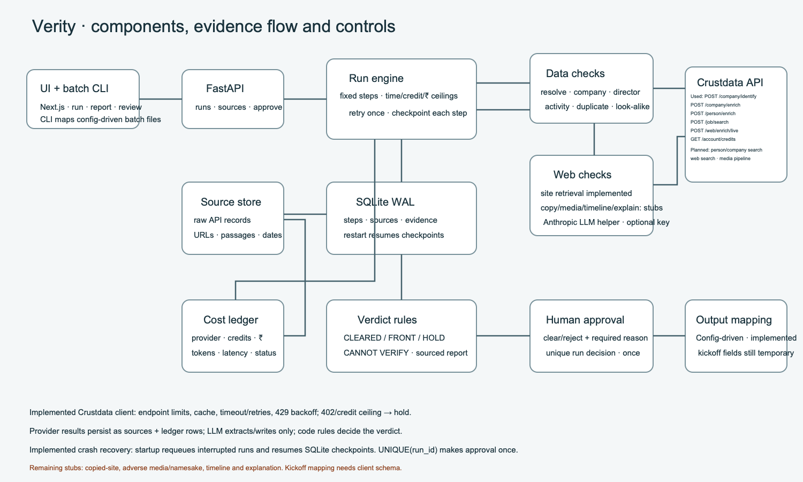

# Veri¯ty

Veri¯ty helps a logistics company review a new carrier or supplier before the first payment. It gathers evidence about identity, trading activity, directors, impersonation, duplicates and history; a person makes the final approval decision.

> **Pitch:** Verity checks whether a new carrier or supplier is real, trading, run by its claimed director and not a duplicate or impersonator. Every conclusion is tied to dated evidence, uncertainty stays visible, and a person approves the final decision once.

## ★ The problem and buyer

★ **Who pays today:** procurement and compliance teams at mid-size Indian 3PLs, and outside verification firms paid per vendor. They currently pay analyst time to reconcile sources that do not share a common key.

★ **Input:** the API accepts one request object with `name` (required), `website`, `director`, `claimed_year`, and `request_text`. The shape is implemented as `RunInput` in `backend/main.py`. The CLI accepts a batch `{"cases":[...]}` file; its temporary `vendor_name`/`request` mapping is in `backend/config.yaml`. The organizer's final kickoff kit/schema and client records are still unavailable, so this mapping must be confirmed before submission.

★ **Finished result:** a report with a verdict, evidence and missing information, followed by a human clear/reject decision with a required reason.

★ **Pass criteria:** expected verdict on each acceptance case in [tests/cases.md](tests/cases.md), every factual claim has a source field or passage and date, no timeout is treated as a negative finding, and an unsupported result becomes HOLD or CANNOT VERIFY. The listed cases use synthetic reserved `.example` fixtures, not live evidence; actual pass/fail results remain pending.

## ★ Architecture



Editable source: [docs/architecture.svg](docs/architecture.svg). The batch CLI, data client and company/site retrieval are implemented. Media screening, copied-site checks, timeline checks and explanation generation remain stubs; the diagram labels these limits.

## Data sources and API use

★ Planned external sources from the project contract:

- Crustdata Company Identify: `POST /company/identify`
- Crustdata Company Enrich: `POST /company/enrich`
- Crustdata Person Enrich: `POST /person/enrich`
- Crustdata Person Search: `POST /person/search`
- Crustdata Company Search: `POST /company/search`
- Crustdata Job Search: `POST /job/search`
- Crustdata Web Search & Fetch: `POST /web/search/live`
- Crustdata credit balance: upstream `GET /account/credits`, exposed by this backend as `GET /credits`
- Vendor websites and public media pages returned through the web layer
- Client vendor records for duplicate checks
- LLM, planned for constrained fact extraction and explanation writing only; it does not decide checks or verdicts.

The Crustdata client and company identify/enrich, person enrich, job search, and site retrieval steps are implemented. The configured calls use Company Identify, Company Enrich, Person Enrich, Job Search, and Web Fetch (`/web/enrich/live`); the client records request sources and provider costs in the ledger and handles timeouts/retries, rate limits, 429 backoff and 402 holds. The currently implemented website step fetches the vendor site and an About page when available. Web Search (`/web/search/live`) and the other planned media/copy checks are not yet run by a completed pipeline step. An Anthropic transport and constrained JSON LLM helper are present; they require an API key and are used for extraction/explanations only, never verdict rules. `/credits` calls Crustdata's account balance helper when configured. No external calls were made during this merge audit; check `NOTES.md` for dated earlier probe/run details and their rule-version caveat.

## Evidence and verdict rules

Evidence items carry `check`, `claim`, `value`, `source_id`, `field_path` or `passage`, `record_date`, `flag`, `status`, and `missing`. The frontend requests `GET /sources/{id}` and shows the stored endpoint, URL, response, retrieval date and record date. It highlights the selected field path when that path exists in the stored API response. A web source uses its passage and a text-fragment URL where supplied. If the backend has no exact field path/passage, the UI reports that limitation rather than inventing one.

The rule engine in `backend/engine/verdict.py` uses evidence and configuration:

- **CANNOT VERIFY:** company unresolved, or all core checks are `cant_verify`.
- **SUSPECTED FRONT:** at least two verified hard flags, or one verified hard flag plus the configured number of soft flags.
- **HOLD FOR REVIEW:** duplicates, multiple candidates, unresolved media, unknown key sources, failed steps, a lone hard flag or soft flags.
- **CLEARED:** company resolved, director confirmed, at least one unflagged activity fact, no hard/soft flags, and no review condition.

Every `cant_verify` item names what is missing. An errored or timed-out source is `unknown`; it is never treated as clean or absent. The report keeps uncertainty visible for human review.

## Reliability, costs and approval

Each run is processed through fixed steps and checkpointed in SQLite. The worker requeues interrupted `running` runs at startup and skips saved completed steps. A failed step is retried once by the engine; after two failures its evidence is `unknown`. The Crustdata client has endpoint rate limits, per-run successful-call caching, timeout/5xx retries and 429 backoff; 402/credit exhaustion holds the run. Time, credit and INR ceilings are read from `backend/config.yaml` and checked before each step. The CLI supports batch input, parallel runs and input-hash resume; do not run it and the API server against the same database simultaneously.

Approval requires `decision`, `reason` (at least three characters), and `user`; `approvals.run_id` is unique and a second attempt receives HTTP 409. Known duplicates cannot be cleared again through the current API. Candidate selection posts an index to `/runs/{id}/select-candidate`.

★ **Finance:** target buyer is 3PL procurement/compliance or a verification firm; pricing is intended to be per vendor. The ledger records provider calls, and `/stats` reports credits, seconds and rupees per finished run. Current `inr_per_credit` and `usd_to_inr` settings are explicitly marked placeholders (Crustdata public credit pricing and a sourced exchange rate are not supplied), so rupee costs and a measured cost comparison are not final. A historical real run is recorded in `NOTES.md` under the earlier rules; do not present it as an acceptance result under the current required-news-screen rule. Sourced proposed pricing and manual-review cost remain pending.

## ★ Ethics and personal data

Director enrichment is limited to at most two people and the intended fields; used fields are written to `personal_data_log` with source and purpose. The UI displays those logged fields with the note “Only fields needed for this check are stored.” The website step and LLM helper exist, but adverse-media matching/namesake clearing, copied-site detection, timeline anomalies and final explanation generation remain stubs. The verdict config requires a verified adverse-media screen for clearance, so a run without it must not clear. The backend requires a person to approve/reject with a reason. The workflow does not contact real people. No retention/deletion job or approved retention period is present.

★ **Retention:** no retention/deletion job or period is implemented in this checkout. A production operator must define an approved retention period and implement deletion before processing real personal data.

## ★ Test results and delivery status

| Case | Expected | Actual |
|---|---|---|
| T1–T8 | See [tests/cases.md](tests/cases.md) | Pending integration with live data steps and client records |

The reserved fixtures test behavior only and do not imply a live company check. The organizer kickoff kit/client records are absent; the field mapping in `backend/config.yaml` is temporary. `tests/cases.inputs.json` contains direct `POST /runs` bodies, while [tests/cases.cli.json](tests/cases.cli.json) uses the current CLI/config mapping and is not claimed to be the organizer's final kickoff schema. Run the offline suite with `PYTHONPATH=. .venv/bin/pytest -q`; latest merged run: **83 passed**. Live expected-versus-actual case results remain pending. The two-minute demo plan is at [docs/DEMO_SCRIPT.md](docs/DEMO_SCRIPT.md); the recording is pending.

★ **Demo video:** Pending. No hosted video URL exists yet; record only after the live data/web integrations are in place. Do not show fixture or stub output as a live check.

## Approaches, limits and next steps

The chosen design is a fixed, checkpointed pipeline with code-based verdict rules and a constrained LLM role. A single LLM agent with tools would be less reproducible and more exposed to prompt injection. A planner that chooses checks could be considered later.

Known limits in this checkout: adverse media/namesake, copied-site, timeline and explanation steps are stubs; no organizer kickoff kit or client records; no final output mapping; cost conversion rates remain placeholders; no current-rule live acceptance results; no data-retention implementation; no recorded demo; source `field_path` is supplied by the clicked evidence item rather than the source endpoint. `npm install` previously reported two advisories (one moderate, one high); registry access failed during that audit, so details remain unverified. Next: obtain kickoff assets, verify real costs, finish remaining web/media checks and explanations, exercise cases and restart/approval flows on the live service, define retention, and record the live demo.

## Setup and run

Backend (Python 3.11):

```sh
python3.11 -m venv .venv
source .venv/bin/activate
python -m pip install -r requirements.txt
cp .env.example .env
uvicorn backend.main:app --reload --port 8000
```

Frontend (Node.js):

```sh
cd frontend
npm install
NEXT_PUBLIC_API_URL=http://localhost:8000 npm run dev
```

Frontend checks: `npm run typecheck`, `npm run lint`, and `npm run build` from `frontend/`.

Batch CLI (the field names currently follow the temporary mapping in `backend/config.yaml`):

```sh
PYTHONPATH=. python -m backend.cli --input tests/cases.cli.json --output /tmp/verity-results.json
```

Environment variables: `CRUSTDATA_API_KEY`, `ANTHROPIC_API_KEY` (or `LLM_API_KEY`), `CRUSTDATA_WEB_FETCH_ENDPOINT`, `VERITY_DB_PATH`, `VERITY_LOG_PATH`, and `NEXT_PUBLIC_API_URL`. Use `.env.example` as a template. Never commit `.env` or credentials.

## ★ Open-source credits and team

Backend dependencies declared: FastAPI, Uvicorn, httpx, rapidfuzz, PyYAML, Pydantic, python-dotenv, pytest, Anthropic SDK and jsonschema. Frontend dependencies: Next.js, React, TypeScript, Tailwind CSS, PostCSS, Autoprefixer, ESLint and `eslint-config-next`. `frontend/package-lock.json` records the frontend install; review transitive licenses before redistribution.

Soumyajit / Lead: API, DB, engine, verdict, duplicate/look-alike, CLI and integration. Member B: Crustdata client, company/director/activity checks, ledger, credits, client-record loader and output mapping. Member C: website retrieval and LLM helper integrated; copied-site, adverse-media/namesake, timeline and explanation steps remain pending. Member D: frontend, acceptance cases, README, architecture diagram and demo preparation.

Repository history begins with the kickoff-period baseline commit visible in Git; no claim of pre-kickoff work is made here.
